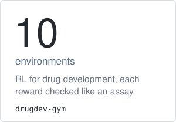

# Di Hu

**Full-stack scientist building autonomous labs with agentic science and physical AI.**

I build the test that tells us whether to trust a result. Did the robot actually load the plate? Did the agent choose the right analysis? Did an intervention help, or did it just move the aging clock?

[Projects by theme](PROJECTS.md) / [The argument behind the work](THESIS.md) / [LinkedIn](https://www.linkedin.com/in/di-hu-phd-4049401a5/)

I earned my PhD at Oxford and co-first-authored a paper in *Nature Communications*. My background is in wet-lab work, single-cell and low-input genomics, automation, and ML.

In November 2026, my team Butterfly Effect won the past.dev challenge at the Iterate AI Research Hackathon for forecasting GPU rental prices. I built the critic that decided which changes to keep. It compared forecasts across 46 past dates and raised the bar with each trial. [Watch the demo](https://www.youtube.com/watch?v=oh6KsCcu3P0).

## Highlights

<a href="https://github.com/di-omics/drugdev-gym"><picture><source media="(prefers-color-scheme: dark)" srcset="assets/highlight-1-dark.svg"></picture></a>
<a href="https://github.com/di-omics/sc-zprime"><picture><source media="(prefers-color-scheme: dark)" srcset="assets/highlight-2-dark.svg"></picture></a>
<a href="https://github.com/di-omics/plr-mcp"><picture><source media="(prefers-color-scheme: dark)" srcset="assets/highlight-3-dark.svg"></picture></a>
<a href="https://github.com/di-omics/autonomous-lab"><picture><source media="(prefers-color-scheme: dark)" srcset="assets/highlight-4-dark.svg"></picture></a>

- **Can we trust the grader?** My independent grader reproduced all 273 published verdicts across 6 scBench example tasks. Tracing the methods on 3 of those tasks showed how a shortcut could still earn a pass. [sc-zprime](https://github.com/di-omics/sc-zprime)
- **What does a robot actually finish?** The scoring rules credited Dream-1 with 7 passes across 45 layouts for 15 simulated chores. One credited handover never happened. A companion project asks how much of that result a judge can recover from the camera images alone. [Handling results](https://github.com/di-omics/robot-lab-handling#results) / [Vision judges](https://github.com/di-omics/robot-lab-judge)
- **What is an RL policy learning?** I test rewards against known outcomes in simulated drug-development tasks. In the first aging-clock benchmark, the model-based policy averaged 0.763 against the scripted reference's 0.890. Over 16 trials the gap was 2.7 standard errors, below the benchmark's threshold of 3. [Drug-development environments](https://github.com/di-omics/drugdev-gym) / [Clock results](https://github.com/di-omics/longevity-rl#aging-clock-benchmark)
- **Can a lab close the loop?** I expose 4 instrument types as agent-callable tools, document instruments that lack an automation API, and test where a workflow breaks between hypothesis and evidence. [Instrument tools](https://github.com/di-omics/plr-mcp) / [Instrument playbooks](https://github.com/di-omics/plr-reverse-engineer) / [Loop evaluation](https://github.com/di-omics/autonomous-lab)

Most of the work here runs in simulation. Individual repositories distinguish simulated results, supervised operations on physical instruments, and measured biological outcomes.

<b>What the evidence labels mean</b>

- **Simulated** means the work ran without attached instruments.
- **Hardware-executed under supervision** means a named operation ran on a physical instrument and its observed result was recorded.
- **Wet/bio-validated** means measured biological data met a stated acceptance criterion.

The supervised run cards and observed failures are kept privately. A full wet end-to-end biological outcome and a customer deployment are both still ahead.

<b>Current projects and results</b>

| Project | Research question | Status |
| --- | --- | --- |
| [drugdev-gym](https://github.com/di-omics/drugdev-gym) | Can the context in bench scientists' heads be captured in a form a model can hill-climb on, with the reward proven true before it is scaled? | v0.1, simulation only. 10 environments; nothing has touched hardware, cells, or compounds |
| [longevity-rl](https://github.com/di-omics/longevity-rl) | Does planning improve batch selection? Can a policy tell when simulated aging clocks are misleading? | Across 100 campaigns, the planner and greedy baseline were statistically indistinguishable. Across 16 clock trials, the model-based policy had a lower mean reward than the scripted reference, with a gap below the 3-standard-error threshold. [Batch results](https://github.com/di-omics/longevity-rl#few-shot-batch-selection) / [Clock results](https://github.com/di-omics/longevity-rl#aging-clock-benchmark) |
| [sc-controls](https://github.com/di-omics/sc-controls) | Do a benchmark task's own controls separate when they are run as code? | 1 scBench task of 195, on the public copy of its data: the method the task notes call correct passes, and the per-cell t-test fails |
| [epigenomics-evals](https://github.com/di-omics/epigenomics-evals) | Can a published paper be turned into evaluation tasks for AI agents, each with controls that test its grader? | 6 tasks from 1 paper I co-first-authored, in LatchBio's public eval format. Independent work, not part of EpiBench. The answer keys have not been reviewed by a person yet |
| [robot-lab-handling](https://github.com/di-omics/robot-lab-handling) | How far does a general robot model get on everyday lab handling when it is only told what to do? | In the first simulated batch, the frozen rules credited Dream-1 with 7 passes across 45 task-layout pairs. Two of those passes are flagged. All 18 layouts for the 6 plate tasks were scored as failures. |
| [robot-lab-judge](https://github.com/di-omics/robot-lab-judge) | From camera pictures alone, can a vision model tell whether a robot's lab chore passed? | simulation only, 475 dev scenes of 10 chores. 3 small open-weight models, zero-shot: the best scores 0.65 balanced accuracy and is at a coin flip on every plate chore. A linear probe, which is a test of the pictures and not a judge, was fitted on scenes from the same simulator and reaches 0.95, so the pictures hold the answer and the zero-shot models do not read it. The probe drops to between 0.70 and 0.81 when the pictures are lightly compressed, shifted by 3 pixels, or both. The sealed test split is unscored, and no person has reviewed the numbers yet |

