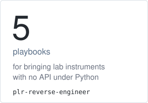

# Di Hu

**Full-stack scientist building autonomous labs with agentic science and physical AI.**

I build RL environments, evals and robot benchmarks for biology, and I check each score the way a wet lab checks an assay: controls that separate, traps that fail, repeats that agree. Did the robot actually load the plate? Did the agent choose the right analysis? Would the reward catch the mistake a bench scientist would catch?

[Projects by theme](PROJECTS.md) / [The argument behind the work](THESIS.md) / [LinkedIn](https://www.linkedin.com/in/di-hu-phd-4049401a5/)

I earned my PhD at Oxford and co-first-authored [a paper in *Nature Communications*](https://doi.org/10.1038/s41467-025-58137-2), which I later turned into [6 evaluation tasks for AI agents](https://github.com/di-omics/epigenomics-evals). My background is in wet-lab work, single-cell and low-input genomics, automation, and ML. Most recently I built an automated biology lab from an empty bench in 3 weeks: more than 10x daily compound testing, and assay CV from about 6% to under 1%.

In November 2026, my team Butterfly Effect won the past.dev challenge at the Iterate AI Research Hackathon for forecasting GPU rental prices. I contributed the critic that decided which changes to keep. It compared forecasts across 46 past dates and raised the bar with each trial. [Watch the demo](https://www.youtube.com/watch?v=oh6KsCcu3P0).

## Highlights

<a href="https://github.com/di-omics/drugdev-gym"><picture><source media="(prefers-color-scheme: dark)" srcset="assets/highlight-1-dark.svg"></picture></a>
<a href="https://github.com/di-omics/sc-zprime"><picture><source media="(prefers-color-scheme: dark)" srcset="assets/highlight-2-dark.svg"></picture></a>
<a href="https://github.com/di-omics/plr-mcp"><picture><source media="(prefers-color-scheme: dark)" srcset="assets/highlight-3-dark.svg"></picture></a>
<a href="https://github.com/di-omics/autonomous-lab"><picture><source media="(prefers-color-scheme: dark)" srcset="assets/highlight-4-dark.svg"></picture></a>

- **Can a reward teach what a bench scientist knows?** I built 10 simulated drug-development environments and paired each bench rule with a trap that breaks only that rule. Of the 62 rule-trap pairs scored, the reward teaches 30 outright and 27 more on average, and is blind to 5. Given only the reward, a learner rediscovered 6 of the 7 checkable dose-response rules. A sister repo applies the same design to longevity research. [Drug-development environments](https://github.com/di-omics/drugdev-gym) / [Longevity environments](https://github.com/di-omics/longevity-rl)
- **Can we trust the grader?** My independent grader agrees with the published verdict on all 1,041 graded runs from 2 public agent benchmarks: 273 of 273 on scBench and 768 of 768 on SpatialBench, both from LatchBio. On differential expression, the per-cell rank test, which the task notes expect to fail, still landed inside the pass window in 13 of the 19 runs that used it. [sc-zprime](https://github.com/di-omics/sc-zprime)
- **What does a robot actually finish?** On 15 simulated lab chores, 3 layouts each, the frozen scoring rules credited Dream-1, a general robot model from Dream Labs, with 7 passes in 45 task-layout pairs and none on the 6 plate chores; 1 of the 7 is a handover that never happened. A companion project asks whether a vision model can judge 10 of these chores from camera pictures alone. [Run table](https://github.com/di-omics/robot-lab-handling/blob/main/runs/2026-11-18-zero-shot/results.md) / [Vision judges](https://github.com/di-omics/robot-lab-judge)
- **Can an AI agent run the experiment, not just analyze it?** Public benchmarks for biology agents mostly grade data analysis. In 3 of my 6 liquid-handling tasks, the agent writes a robot plan and the grader runs it on a simulated liquid handler, checking what ends up in the wells; 61 scripted controls check the graders. The instruments and the loop behind these tasks are in the path below. [Lab automation evals](https://github.com/di-omics/lab-automation-evals)

## From an instrument to an agent-run experiment

The lab side of this work is one path, with a public repository for each step.

1. **Get the instrument talking.** For instruments with no published automation API: capture the vendor software's traffic, decode it, and replay it behind safety guards. Playbooks for 5 instruments so far. [plr-reverse-engineer](https://github.com/di-omics/plr-reverse-engineer)
2. **Give the agent one interface.** A liquid handler, a plate reader, a thermocycler and a heater-shaker as tools any AI agent can call. Simulation by default; hardware permission is enforced in code. [plr-mcp](https://github.com/di-omics/plr-mcp)
3. **Add the scientist's judgment, then check the liquid.** A step-by-step guide from first contact with a liquid handler to tunable liquid-handling parameters and a dye plate that is read, scored and used to readjust. The example reads are synthetic. [Agentic Lab Guide](https://di-omics.github.io/agentic-lab-guide/)
4. **Close the loop and name where it breaks.** Computes whether a lab can go from hypothesis to evidence across 4 stages, with QC gates, scheduling and provenance. [autonomous-lab](https://github.com/di-omics/autonomous-lab)
5. **Grade the agent on the run, not only on the analysis.** 6 liquid-handling tasks whose graders are checked by 61 scripted controls. [lab-automation-evals](https://github.com/di-omics/lab-automation-evals)
6. **Hold the science to the same bar.** 6 analysis decisions from a paper I co-first-authored, as evaluation tasks, each with scripted controls that test its grader. [epigenomics-evals](https://github.com/di-omics/epigenomics-evals)

Most of the public work here runs in simulation, and each repository says so.

<b>What is simulated and what is not</b>

Every public result here is simulated unless its README says otherwise. The run cards from supervised runs on physical instruments are kept privately, and no wet end-to-end biological result is claimed in these repositories yet.

<b>Current projects and results</b>

| Project | Question | Result so far |
| --- | --- | --- |
| [drugdev-gym](https://github.com/di-omics/drugdev-gym) | Can the context in bench scientists' heads be captured in a form a model can hill-climb on, with the reward proven true before it is scaled? | v0.1, 10 simulated environments. The reward teaches 30 of 62 scored rule-trap pairs outright and 27 more on average, and is blind to 5. Nothing has touched hardware, cells, or compounds |
| [longevity-rl](https://github.com/di-omics/longevity-rl) | Does planning improve batch selection? Can a policy tell when simulated aging clocks are misleading? | 2 simulated benchmarks with a hidden truth. So far, 2-round planning finds no more hits than a greedy ranking (41.42 against 42.05 per campaign, over 100 campaigns), and the model-based policy does not beat the scripted reference (0.763 against 0.890 over 16 trials). [Batch results](https://github.com/di-omics/longevity-rl#few-shot-batch-selection) / [Clock results](https://github.com/di-omics/longevity-rl#aging-clock-benchmark) |
| [sc-controls](https://github.com/di-omics/sc-controls) | Do a benchmark task's own controls separate when they are run as code? | 1 scBench task of 195, on the public copy of its data: the method the task notes call correct passes, and the per-cell t-test fails |
| [epigenomics-evals](https://github.com/di-omics/epigenomics-evals) | Can a published paper be turned into evaluation tasks for AI agents, each with controls that test its grader? | 6 tasks from 1 paper I co-first-authored, in LatchBio's public eval format; 43 of 43 scripted controls behave as expected. Independent work, not part of EpiBench. No person has reviewed the controls or the answer keys yet |
| [lab-automation-evals](https://github.com/di-omics/lab-automation-evals) | Can an AI agent run lab work, not just analyze the data afterwards? | 6 liquid-handling tasks; in the 3 planning tasks the agent's robot plan runs on a simulated liquid handler and is graded by what ends up in the wells. 61 of 61 scripted controls behave as expected. 1 blind run per task by Claude Opus 5.5 passed all 6, so the tasks are fair but not yet hard. No person has reviewed the tasks or the keys yet |
| [robot-lab-handling](https://github.com/di-omics/robot-lab-handling) | How far does a general robot model get on everyday lab handling when it is only told what to do? | In the first simulated batch, the frozen rules credited Dream-1 with 7 passes across 45 task-layout pairs. 2 of those passes are flagged. All 18 layouts for the 6 plate tasks were scored as failures. |
| [robot-lab-judge](https://github.com/di-omics/robot-lab-judge) | From camera pictures alone, can a vision model tell whether a robot's lab chore passed? | 475 simulated development scenes of 10 chores. Zero-shot, the best of 3 small open-weight models scores 0.65 balanced accuracy and is at a coin flip on every plate chore. A linear probe, a test of the pictures and not a judge, fitted on scenes from the same simulator, reaches 0.95, so the pictures hold the answer. The probe drops to between 0.70 and 0.81 when the pictures are lightly compressed, shifted by 3 pixels, or both. The sealed test split is unscored |

