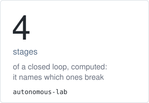

# Di Hu

**full-stack scientist - building autonomous labs**

Bridging the embodiment gap between scientific expertise and robotic execution, with
sequential, baked-in, measurable QC.

My work turns protocols, acceptance criteria, and failure responses into gated, auditable
execution across laboratory hardware. This profile is a public portfolio of reusable
automation, omics, robotics, and evaluation systems.

Oxford PhD / joint first author in *Nature Communications* / wet lab, genomics, automation,
computation, and ML.

[The argument](THESIS.md) / [Benchmarks](https://di-omics.github.io/benchmarks/) /
[LinkedIn](https://www.linkedin.com/in/di-hu-phd-4049401a5/) /
[Writing](https://reinhaudt.com)

## Highlights

<a href="https://github.com/di-omics/drugdev-gym"><picture><source media="(prefers-color-scheme: dark)" srcset="assets/highlight-1-dark.svg"></picture></a>
<a href="https://github.com/di-omics/plr-mcp"><picture><source media="(prefers-color-scheme: dark)" srcset="assets/highlight-2-dark.svg"></picture></a>
<a href="https://github.com/di-omics/plr-reverse-engineer"><picture><source media="(prefers-color-scheme: dark)" srcset="assets/highlight-3-dark.svg"></picture></a>
<a href="https://github.com/di-omics/autonomous-lab"><picture><source media="(prefers-color-scheme: dark)" srcset="assets/highlight-4-dark.svg"></picture></a>

- **[drugdev-gym](https://github.com/di-omics/drugdev-gym)** -- new in November 2026. Ten
  RL environments for cell assays and drug development, each running on a simulated liquid
  handler. Every reward is validated like an assay before it is scaled: the expert protocol
  against named bench mistakes, over the same seeds. More than 800 tests. Simulation only.
  Sister repo [longevity-gym](https://github.com/di-omics/longevity-gym): did an intervention make simulated people younger, or
  only move the aging clocks? Nothing in it is trained on real data.
- **[sc-zprime](https://github.com/di-omics/sc-zprime)** -- new in November 2026. Assay-style
  validation of scBench, LatchBio's public single-cell agent benchmark. An independent grader
  reproduces all 273 published verdicts, then measures how well each pass window separates
  the intended method from named traps. Six example tasks, public runs only.
- **[plr-mcp](https://github.com/di-omics/plr-mcp)** -- a liquid handler, a plate reader, a
  thermocycler, and a heater-shaker as MCP tools that any agent can call. Simulation by
  default, with hardware permission enforced in code.
- **[plr-reverse-engineer](https://github.com/di-omics/plr-reverse-engineer)** -- capture,
  decode, and guarded replay for instruments with no automation API. Five playbooks so far,
  each with its status stated: a cell sorter, an LC/MS, a solvent evaporator, a DNA
  sequencer, and a single-cell dispenser.
- **[autonomous-lab](https://github.com/di-omics/autonomous-lab)** -- computes whether a lab
  can close a loop from hypothesis to evidence across four stages (execute, measure, decide,
  record), and names the one that breaks.

## Now

What I am building in the open right now. The status column says how far along each one is.

| | The question | Status |
| --- | --- | --- |
| [drugdev-gym](https://github.com/di-omics/drugdev-gym) | Can the context in bench scientists' heads be captured in a form a model can hill-climb on, with the reward proven true before it is scaled? | v0.1, simulation only. Ten environments; nothing has touched hardware, cells, or compounds |
| [longevity-gym](https://github.com/di-omics/longevity-gym) | Did an intervention make simulated people biologically younger, or only move the clocks? One environment, eight simulated clocks, twelve named mistakes | v0.1, simulation only. No real proteomic, methylation, clock, or trial data in the repo |
| [robot-policy-evals](https://github.com/di-omics/robot-policy-evals) | Is the gain real? A known-truth audit of how robot-policy checkpoints get picked and reported, piloted on Reacher-v5, then on Diffusion Policy / PushT | plan and draft pre-registration committed; nothing run yet beyond environment checks |
| [liquid-policy-robustness](https://github.com/di-omics/liquid-policy-robustness) | Do liquid neural networks control a robot arm better under sensor noise than matched-size MLPs and LSTMs? | teacher, demonstrations, and student training run; the noise sweep has not been run |
| [ml-foundations](https://github.com/di-omics/ml-foundations) | The PyTorch training loop from the inside, on FashionMNIST | warm-up, in progress |

## Capabilities

| | | |
| --- | --- | --- |
| **Autonomous lab** | orchestration, QC gates, provenance, recovery, honest hardware boundaries | [autonomous-lab](https://github.com/di-omics/autonomous-lab) |
| **Robotics** | arm control under PyLabRobot, eye-in-hand vision, instrument reverse engineering | [plr-lab-robot](https://github.com/di-omics/plr-lab-robot) |
| **Computer vision and image analysis** | detection, state, tracking, camera-verified execution, scored blind | [lab-cv](https://github.com/di-omics/lab-cv) |
| **RL environments** | simulated assay, potency, stability, and aging-clock environments, with rewards validated like assays | [drugdev-gym](https://github.com/di-omics/drugdev-gym), [longevity-gym](https://github.com/di-omics/longevity-gym) |
| **ML for biology** | protein design loops, Bayesian assay optimization, conformal QC | [ml-design-loops](https://github.com/di-omics/ml-design-loops) |
| **Benchmarks and evals** | the metric each capability is scored on, and which numbers are still pending | [benchmarks](https://github.com/di-omics/benchmarks) |

Each row states its own evidence boundary. Most of this is simulated, and every repository
says so.

## What it is all for

Every layer here exists to serve one number: **how much a lab learns per dollar per
experimental cycle.** Orchestration is buildable: scheduling instruments, moving plates,
tracking samples, and holding provenance are engineering with known shapes, and the code
here does them. What is genuinely scarce is **laboratory intelligence**: knowing what a
result means, what to run next, when a clean-looking plate should be thrown away, and what a
robot must prove before it is trusted with the step.

So the portfolio is built around making that judgment explicit, attributable, and checkable.
The full argument, the four stages of a closed loop, and the order the stack has to be built
in are in **[THESIS.md](THESIS.md)**.

## Current evidence boundary

Some named operations have been executed on physical instruments under human supervision.
Most of the portfolio remains simulated. There is no customer deployment and no full wet
end-to-end biological endpoint yet. Each repository states its own evidence and validation
boundary, and the language is deliberately narrow:

- **Simulated** -- exercised without attached instruments.
- **Hardware-executed under supervision** -- a named interaction ran on a physical
  instrument and its observed result is recorded.
- **Wet/bio-validated** -- measured biological data met a stated acceptance criterion.

Unknowns stay unknown until evidence clears the next gate. A simulator result never becomes
a hardware or biological claim by wording alone.

The supervised physical-instrument run cards and observed failures live in `plr-tested`
*(private)*. It is private because the work is high stakes, and a reader who cannot inspect
the evidence should not be shown a claim resting on it.

## Repositories

**Autonomous lab**

| | |
| --- | --- |
| [autonomous-lab](https://github.com/di-omics/autonomous-lab) | evidence and permission for autonomous labs: computes whether a loop closes, and names which stage breaks |
| [plr-mcp](https://github.com/di-omics/plr-mcp) | typed, agent-callable lab tools; the arming model is enforced in code, not documented |
| [plr-reverse-engineer](https://github.com/di-omics/plr-reverse-engineer) | capture, decode, guarded replay for no-API instruments; incomplete maps stay blocked from actuation |
| [benchmarks](https://github.com/di-omics/benchmarks) | the evaluation index: what each capability is scored on, and which numbers are still pending |
| `plr-tested` *(private)* | supervised physical-instrument run cards and observed failures, kept as evidence |

**RL environments and ML**

| | |
| --- | --- |
| [drugdev-gym](https://github.com/di-omics/drugdev-gym) | RL environments for cell assays and drug development on a simulated liquid handler, with every reward validated like an assay |
| [longevity-gym](https://github.com/di-omics/longevity-gym) | one RL environment for aging clocks: did the intervention make simulated people younger, or only move the clocks; sister repo to drugdev-gym, trained on nothing real |
| [ml-design-loops](https://github.com/di-omics/ml-design-loops) | ESM-2 protein design, Bayesian assay optimization under a conformal gate, and an agentic design-build-test-learn engine |
| [sc-zprime](https://github.com/di-omics/sc-zprime) | assay-style validation of scBench, LatchBio's public single-cell agent benchmark: how well each pass window separates the intended method from named traps |
| [robot-policy-evals](https://github.com/di-omics/robot-policy-evals) | a known-truth audit of how robot-policy checkpoints get picked and reported |
| [liquid-policy-robustness](https://github.com/di-omics/liquid-policy-robustness) | liquid neural networks against matched-size MLPs and LSTMs under sensor noise |
| [ml-foundations](https://github.com/di-omics/ml-foundations) | a first PyTorch training project, kept as a lab notebook |

**Robotics and vision**

| | |
| --- | --- |
| [plr-lab-robot](https://github.com/di-omics/plr-lab-robot) | a simulation backend for PyLabRobot's arm API, which upstream ships without |
| [lab-cv](https://github.com/di-omics/lab-cv) | detection, state classification, tracking, camera-verified liquid handling, and microscopy image analysis; every demo scored blind against a plant |
| [awesome-wetlab-cv](https://github.com/di-omics/awesome-wetlab-cv) | curated CV for labs that see, decide, and act -- with CI that checks every link |
| [robotics-devkit](https://github.com/di-omics/robotics-devkit) | plugin marketplace and template for the code-to-simulation-to-real-robot ladder, with MCP tools and test agents |

**Instruments and protocols**

| | |
| --- | --- |
| [opentrons-drivers](https://github.com/di-omics/opentrons-drivers) | serial GCode for the OT-One Smoothieboard, HTTP for OT-2 and Flex, with a simulator |
| [ot-flex-automation](https://github.com/di-omics/ot-flex-automation) | Opentrons Flex workflows for whole-genome sequencing, methylation sequencing, and TIP-seq, with explicit off-deck handoffs and validation status |
| [fullstack-omics](https://github.com/di-omics/fullstack-omics) | simulator-only scRNA-seq and whole-genome sequencing workflows, from planning through analysis handoffs |
| [omics-demos](https://github.com/di-omics/omics-demos) | synthetic, ground-truth demos for scRNA-seq, methylation sequencing, and PCR enrichment QC; no wet-lab claims |
| [plr-minimum-effective](https://github.com/di-omics/plr-minimum-effective) | finds the cheapest sequencing library prep that still gives a callable answer: unique reads per dollar, gated on in-process CV |
| [spatial-flow](https://github.com/di-omics/spatial-flow) | spatial-biology lab operations: specimen lineage and TMA batch-balance planning |

**Hack days**

| | |
| --- | --- |
| [bay-hack](https://github.com/di-omics/bay-hack) | verified tube access: no verified opening, no pipetting -- enforced in code and in the sealed receipt |
| [someplace](https://github.com/di-omics/someplace) | a voice companion inside a generated world |

## About

Python / PyLabRobot / MCP and agent harnesses / robotic manipulation and computer vision -
single-cell and low-input NGS.

[LinkedIn](https://www.linkedin.com/in/di-hu-phd-4049401a5/) / [Writing / thesis](https://reinhaudt.com)
