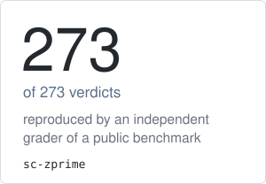

# Di Hu

**full-stack scientist - building autonomous labs**

Bridging the embodiment gap between scientific expertise and robotic execution, with
sequential, baked-in, measurable QC.

My work turns protocols, acceptance criteria, and failure responses into gated, auditable
execution across laboratory hardware. The piece that recurs across this profile is the test
that decides whether a result is real: for an assay, an agent benchmark, an RL reward, or a
change to a model.

Oxford PhD / joint first author in *Nature Communications* / wet lab, single-cell and
low-input genomics, automation, computation, and ML.

[The argument](THESIS.md) / [LinkedIn](https://www.linkedin.com/in/di-hu-phd-4049401a5/)

**November 2026:** 1st place in the past.dev challenge at the Iterate AI Research Hackathon,
with team Butterfly Effect. A language model proposes changes to a GPU price forecaster, and a
critic decides which are kept. I contributed the critic: a sign test over 46 past forecast
dates, with a bar that gets stricter at every trial.
[Demo video](https://www.youtube.com/watch?v=oh6KsCcu3P0).

## Highlights

<a href="https://github.com/di-omics/drugdev-gym"><picture><source media="(prefers-color-scheme: dark)" srcset="assets/highlight-1-dark.svg"></picture></a>
<a href="https://github.com/di-omics/sc-zprime"><picture><source media="(prefers-color-scheme: dark)" srcset="assets/highlight-2-dark.svg"></picture></a>
<a href="https://github.com/di-omics/plr-mcp"><picture><source media="(prefers-color-scheme: dark)" srcset="assets/highlight-3-dark.svg"></picture></a>
<a href="https://github.com/di-omics/autonomous-lab"><picture><source media="(prefers-color-scheme: dark)" srcset="assets/highlight-4-dark.svg"></picture></a>

- **[drugdev-gym](https://github.com/di-omics/drugdev-gym)** -- ten RL environments for cell assays and drug
  development, each on a simulated liquid handler. Every reward is checked like an assay
  before it is scaled: the expert protocol against named bench mistakes, over the same seeds,
  with a table of what the reward cannot see. Simulation only. Sister repo
  [longevity-gym](https://github.com/di-omics/longevity-gym) asks the same of aging clocks: did an intervention make
  simulated people younger, or only move the clocks? Nothing in it is trained on real data.
- **[sc-zprime](https://github.com/di-omics/sc-zprime)** -- assay-style validation of scBench, LatchBio's public
  single-cell agent benchmark. An independent grader reproduces all 273 published verdicts,
  then measures how well each pass window separates the intended method from named traps.
  Six example tasks, public runs only. Sibling [sc-controls](https://github.com/di-omics/sc-controls) runs scripted
  positive and negative controls for one of those tasks on the public copy of its data.
- **[lab-handling-bench](https://github.com/di-omics/lab-handling-bench)** -- how far does a general robot model get on
  the handling chores around a liquid handler, when a scientist just tells it what to do? 15
  two-arm tasks in simulation, scored from the simulator with no human judging, under a
  protocol written before the first scored take. Dream-1 runs zero-shot; most takes do not
  pass yet.
- **[plr-mcp](https://github.com/di-omics/plr-mcp)** -- a liquid handler, a plate reader, a thermocycler, and a
  heater-shaker as MCP tools that any agent can call. Simulation by default, with hardware
  permission enforced in code.
- **[plr-reverse-engineer](https://github.com/di-omics/plr-reverse-engineer)** -- capture, decode, and guarded replay
  for instruments with no automation API. Five playbooks so far, each with its status stated:
  a cell sorter, an LC/MS, a solvent evaporator, a DNA sequencer, and a single-cell dispenser.
- **[autonomous-lab](https://github.com/di-omics/autonomous-lab)** -- computes whether a lab can close a loop from
  hypothesis to evidence across four stages (execute, measure, decide, record), and names the
  one that breaks.

## Evidence boundary

Most of this portfolio is simulated, and each repository says so. Some named operations have
run on physical instruments under supervision. There is no customer deployment and no full
wet end-to-end biological endpoint yet. Three terms are used narrowly:

- **Simulated** -- exercised without attached instruments.
- **Hardware-executed under supervision** -- a named interaction ran on a physical
  instrument and its observed result is recorded.
- **Wet/bio-validated** -- measured biological data met a stated acceptance criterion.

A simulator result never becomes a hardware or biological claim by wording alone. The
supervised run cards and observed failures are kept in `plr-tested` *(private)*, because a
reader who cannot inspect the evidence should not be shown a claim resting on it.

## Now

| | The question | Status |
| --- | --- | --- |
| [drugdev-gym](https://github.com/di-omics/drugdev-gym) | Can the context in bench scientists' heads be captured in a form a model can hill-climb on, with the reward proven true before it is scaled? | v0.1, simulation only. Ten environments; nothing has touched hardware, cells, or compounds |
| [longevity-gym](https://github.com/di-omics/longevity-gym) | Did an intervention make simulated people biologically younger, or only move the clocks? One environment, eight simulated clocks, twelve named mistakes | v0.1, simulation only. No real proteomic, methylation, clock, or trial data in the repo |
| [sc-controls](https://github.com/di-omics/sc-controls) | Do a benchmark task's own controls separate when they are run as code? | one scBench task of 195, on the public copy of its data: the method the task notes call correct passes, and the per-cell t-test fails |
| [epigenomics-evals](https://github.com/di-omics/epigenomics-evals) | Can a published paper be turned into evaluation tasks for AI agents, each with controls that test its grader? | 6 tasks from one paper I co-first-authored, in LatchBio's public eval format. Independent work, not part of EpiBench. The answer keys have not been reviewed by a person yet |
| [lab-handling-bench](https://github.com/di-omics/lab-handling-bench) | How far does a general robot model get on everyday lab handling when it is only told what to do? | simulation only. Dream-1 run zero-shot on 15 two-arm tasks, plus a small camera-guided pilot on one task; most takes do not pass yet. No real-robot results |

<b>All repositories, by theme</b>

**Evals**

| | |
| --- | --- |
| [sc-zprime](https://github.com/di-omics/sc-zprime) | assay-style validation of scBench, LatchBio's public single-cell agent benchmark: how well each pass window separates the intended method from named traps |
| [sc-controls](https://github.com/di-omics/sc-controls) | scripted positive and negative controls for one scBench task, run on the public copy of its data and graded with the task's own window |
| [epigenomics-evals](https://github.com/di-omics/epigenomics-evals) | 6 epigenomics eval tasks for AI agents, built from one published paper, each with the scripted controls its grader was tested against; independent work, not part of LatchBio's EpiBench |
| [lab-handling-bench](https://github.com/di-omics/lab-handling-bench) | zero-shot robot models on 15 everyday lab handling tasks, two YAM arms in simulation, scored from the simulator state |
| [robot-policy-evals](https://github.com/di-omics/robot-policy-evals) | a known-truth audit of how robot-policy checkpoints get picked and reported; plan stage, nothing run yet |
| [liquid-policy-robustness](https://github.com/di-omics/liquid-policy-robustness) | liquid neural networks against matched-size MLPs and LSTMs under sensor noise; the noise sweep has not been run |
| [benchmarks](https://github.com/di-omics/benchmarks) | how the July 2026 lab-automation and omics repositories are evaluated, and which numbers are still pending |

**RL environments and ML**

| | |
| --- | --- |
| [drugdev-gym](https://github.com/di-omics/drugdev-gym) | RL environments for cell assays and drug development on a simulated liquid handler, with every reward checked like an assay |
| [longevity-gym](https://github.com/di-omics/longevity-gym) | one RL environment for aging clocks: did the intervention make simulated people younger, or only move the clocks; sister repo to drugdev-gym, trained on nothing real |
| [ml-design-loops](https://github.com/di-omics/ml-design-loops) | ESM-2 protein design, Bayesian assay optimization under a conformal gate, and an agentic design-build-test-learn engine; simulation only |
| [ml-foundations](https://github.com/di-omics/ml-foundations) | a first PyTorch training project, kept as a lab notebook |

**Autonomous lab**

| | |
| --- | --- |
| [autonomous-lab](https://github.com/di-omics/autonomous-lab) | evidence and permission for autonomous labs: computes whether a loop closes, and names which stage breaks |
| [plr-mcp](https://github.com/di-omics/plr-mcp) | typed, agent-callable lab tools; the arming model is enforced in code, not documented |
| [plr-reverse-engineer](https://github.com/di-omics/plr-reverse-engineer) | capture, decode, guarded replay for no-API instruments; incomplete maps stay blocked from actuation |
| `plr-tested` *(private)* | supervised physical-instrument run cards and observed failures, kept as evidence |

**Robotics and vision**

| | |
| --- | --- |
| [plr-lab-robot](https://github.com/di-omics/plr-lab-robot) | a simulation backend for PyLabRobot's arm API, which upstream ships without |
| [lab-cv](https://github.com/di-omics/lab-cv) | detection, state classification, tracking, camera-verified liquid handling, and microscopy image analysis; every demo scored blind against a plant |
| [awesome-wetlab-cv](https://github.com/di-omics/awesome-wetlab-cv) | curated CV for labs that see, decide, and act -- with CI that checks every link |
| [robotics-devkit](https://github.com/di-omics/robotics-devkit) | plugin marketplace and template for the code-to-simulation-to-real-robot ladder, with MCP tools and test agents |

**Instruments and protocols**

| | |
| --- | --- |
| [opentrons-drivers](https://github.com/di-omics/opentrons-drivers) | serial GCode for the OT-One Smoothieboard, HTTP for OT-2 and Flex, with a simulator |
| [ot-flex-automation](https://github.com/di-omics/ot-flex-automation) | Opentrons Flex workflows for whole-genome sequencing, methylation sequencing, and TIP-seq, with explicit off-deck handoffs and validation status |
| [fullstack-omics](https://github.com/di-omics/fullstack-omics) | simulator-only scRNA-seq and whole-genome sequencing workflows, from planning through analysis handoffs |
| [omics-demos](https://github.com/di-omics/omics-demos) | synthetic, ground-truth demos for scRNA-seq, methylation sequencing, and PCR enrichment QC; no wet-lab claims |
| [plr-minimum-effective](https://github.com/di-omics/plr-minimum-effective) | finds the cheapest sequencing library prep that still gives a callable answer: unique reads per dollar, gated on in-process CV |
| [spatial-flow](https://github.com/di-omics/spatial-flow) | spatial-biology lab operations: specimen lineage and TMA batch-balance planning |

**Hackathons**

| | |
| --- | --- |
| Butterfly Effect *(team repo, private)* | 1st place in the past.dev challenge, Iterate AI Research Hackathon, November 2026: I contributed the critic of the research loop |
| [bay-hack](https://github.com/di-omics/bay-hack) | verified tube access: no verified opening, no pipetting -- enforced in code and in the sealed receipt |
| [someplace](https://github.com/di-omics/someplace) | a voice companion inside a generated world |

